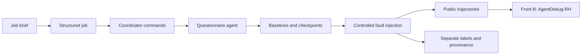

# Scenario Emulator · Front A

🇺🇸 **English** · [🇧🇷 Português](README.pt-BR.md)

A failure simulator for recruitment agents. It generates questionnaires, records
execution trajectories, and builds controlled datasets to evaluate
**AgentDebug-RH**, which locates the critical failure and proposes a correction.

[Get started](#get-started) · [Front A guide](docs/error-recovery.md) ·
[Development](#development) · [Fault catalog](docs/fault-injection-catalog.md) ·
[Data contract](docs/data-contracts/agentdebug.md)



The campaigns measure how well a detector localizes the critical cause in
trajectories with known failures, and how often it raises false positives on
clean controls.

The agent under test works in Brazilian Portuguese: its prompts, tools, job
briefs and the generated trajectories are in Portuguese. Code, documentation and
command output are in English.

## Get started

Requirements: **Python 3.12+**, Git and [`uv`](https://docs.astral.sh/uv/).
Generating new baselines also needs an LLM provider; tests and configuration
checks run offline. Run every command from the repository root, because profile
and campaign paths are relative to the working directory.

1. Clone the repository and install the locked dependencies:

   ```bash
   git clone https://github.com/PDC-PDAI/scenario-emulator.git
   cd scenario-emulator
   uv sync --locked
   cp .env.example .env
   ```

2. Configure a provider in `.env`. For OpenAI:

   ```dotenv
   LLM_PROVIDER=openai
   OPENAI_API_KEY=your-key
   OPENAI_MODEL=gpt-5-mini
   ```

   For Ollama, set `LLM_PROVIDER=ollama`, `OLLAMA_BASE_URL` and `OLLAMA_MODEL`
   as shown in [.env.example](.env.example). Langfuse is optional: with the
   three `LANGFUSE_*` credentials empty, nothing is traced and the runtime uses
   the local prompts in `src/prompts/raw_prompts.py`. With credentials, prompts
   are fetched from Langfuse by `LANGFUSE_PROMPT_LABEL` and fall back to the local
   copies on error.

3. Verify the installation offline:

   ```bash
   uv run scenario-emulator validate-profile configs/fronts/error_recovery.yaml
   uv run pytest -q
   ```

4. Generate one real baseline. This calls the configured provider:

   ```bash
   uv run scenario-emulator run \
     --profile configs/fronts/error_recovery.yaml \
     --brief "Vaga sênior de backend Python, FastAPI e PostgreSQL" \
     --benign 1
   ```

   The command writes `scenario.json`, `benchmark.jsonl`, `agent-debug.jsonl`
   and `trajectories/` under `outputs/error_recovery/`, then prints how many
   trajectories passed the scenario oracle. `error_recovery` is also the default
   profile when `--profile` is omitted; without `--benign` it generates three
   benign commands. The [Front A guide](docs/error-recovery.md#generate-trajectories)
   shows how to write each run to its own directory.

## Current campaign: 300 samples per model

The [fixed campaign](configs/campaigns/front-a-fixed-300.yaml) collects
**300 samples per model: 60 clean controls and 240 injected faults**. Its
[versioned corpus](configs/inputs/front-a-300.json) holds 10 job openings ×
30 distinct commands. Every model receives the same jobs, commands, IDs,
guidelines and local prompts; no LLM regenerates these inputs. The default model
is **Gemma 4 31B** on OpenRouter.

1. Set `OPENROUTER_API_KEY` in `.env` (see [.env.example](.env.example)).
   The fixed campaign ignores `LLM_PROVIDER`: it calls OpenRouter with this key
   (or with `OPENAI_API_KEY` when `OPENAI_BASE_URL` points to OpenRouter) and
   always uses the local prompts.

2. Validate the campaign and its 300 inputs without calling any LLM:

   ```bash
   uv run scenario-emulator validate-dataset-campaign configs/campaigns/front-a-fixed-300.yaml
   ```

3. Run a five-sample Gemma 4 31B pilot in its own directory:

   ```bash
   uv run scenario-emulator run-dataset \
     --campaign configs/campaigns/front-a-fixed-300.yaml \
     --limit 5 \
     --output-dir outputs/front-a-smoke-5/gemma-4-31b
   ```

4. Run the full 300-sample Gemma 4 31B collection. It writes to
   `outputs/front-a-300/google-gemma-4-31b-it`:

   ```bash
   uv run scenario-emulator run-dataset \
     --campaign configs/campaigns/front-a-fixed-300.yaml
   ```

5. Collect another model with the same inputs and parameters. `--model` changes
   only the model and writes to `outputs/front-a-300/<model ID with / replaced by _>`:

   ```bash
   uv run scenario-emulator run-dataset \
     --campaign configs/campaigns/front-a-fixed-300.yaml \
     --model qwen/qwen3.5-9b
   ```

The YAML fixes `temperature=0`, `top_p=1`, `max_tokens=8192`, reasoning disabled,
2 transport retries, a 120-second timeout and seed 42 for the fault assignment.
OpenRouter receives `require_parameters=true` and `allow_fallbacks=false`.

### Collection status

| Model | OpenRouter ID | Status |
| --- | --- | --- |
| [Gemma 4 31B](https://openrouter.ai/google/gemma-4-31b-it) | `google/gemma-4-31b-it` | Complete: 300 samples (60 controls, 240 faults), default OpenRouter routing. |
| [Qwen 3.5 9B](https://openrouter.ai/qwen/qwen3.5-9b) | `qwen/qwen3.5-9b` | Complete: 276 samples with default routing and 24 resumed on `deepinfra/bf16` with the exact-count tool contract ([details](#qwen-budgeted-resume-and-exact-count-contract)). |
| [GLM 5.2](https://openrouter.ai/z-ai/glm-5.2) | `z-ai/glm-5.2` | Complete: 300 samples on `deepinfra/fp4` ([details](#glm-models)). |
| [GLM 5.3 Flash](https://openrouter.ai/z-ai/glm-5.3-flash) | `z-ai/glm-5.3-flash` | Incompatible with the protocol: no accepted samples. |
| [Gemma 4 26B](https://openrouter.ai/google/gemma-4-26b-a4b-it) | `google/gemma-4-26b-a4b-it` | Not collected; use step 5 with this ID. |

Collected datasets live in the git-ignored `outputs/` directory of the machine
that ran them; a clone does not include them. Each finished model has a
delivery folder, `drive-five-jsons/`, described in
[Package a delivery](#package-a-delivery).

### Distribution

`success_controls: 60` reserves six clean controls per job opening, selected
with the fixed seed. The remaining 240 cases receive the eleven fault types:
22 per type, except `system_llm_limit` and `system_environment_error`, with 21
each. The same position is a control, or receives the same fault type, for every
model. The pilot is the exact prefix of the full schedule, so five cases do not
represent the global proportions.

### Detector input and metrics

Give the detector `detector-input.jsonl`. It contains only `trajectory_id`,
`task_description`, `environment` and `steps`, mixing controls and faults. Keep
`labels.json` separate: `null` means no expected fault, and the other values hold
`step`, `module` and `error_type`. Join predictions and labels by `trajectory_id`
only after inference. Never give the detector the labels, the manifest, the
fault assignment or the `success` field.

`front-b-input.jsonl` keeps the legacy contract, including `success`, for
integration. Because Front B may skip cases with `success=true`, measure false
positives with the blind input and process every case. See the
[evaluation protocol](docs/dataset-v2-success-controls.md#blind-evaluation).

### Fault positions

`invalid_action`, `action_format_error`, `system_tool_execution_error` and
`system_llm_limit` rotate across the steps that hold a valid tool call, with
three variants per position. When the fault lands before the last step, the
trajectory is truncated at the fault so it never shows a fictitious successful
continuation. The other types keep their semantically required position (for
example, saving before the lookup, or corrupting the payload when saving). No
steps are added just to balance positions. With two-step baselines the planned
distribution of the 240 faults is 92 at step 1 and 148 at step 2; longer
baselines also expose intermediate positions to the flexible types. The actual
counts, including type × step and original trajectory length, are written to
`private/distribution.json`.

### Reproduce and resume

Repeat the same command with the same output directory to reuse the approved
checkpoints. A baseline that fails, or that contains a recovered natural error,
stays pending under its original ID; the next run repeats the same command
without replacing it or shifting the labels. The process exits with code 2 while
cases are pending, and only a valid baseline receives the synthetic fault. Each
faulty case holds exactly one injection, and controls keep the clean trajectory.
A control requires a successful lookup and save, with consistent calls and
responses across the full message history. Rejected attempts are kept in
`private/rejected-executions/`.

The private manifest records the protocol and its hashes. Changing the model,
generation parameters, corpus, code, dependencies or `--limit` therefore requires
a new output directory: the runtime hash covers every file under `src/` and
`uv.lock`, and a mismatch stops the run with `Protocol/model/limit changed`. Use
separate directories for pilots and full collections, and keep the same input IDs
in the same evaluation split across models.

Temperature 0 fixes the sampling policy, but OpenRouter and its backends do not
guarantee identical responses to new calls. The protocol fixes inputs,
parameters and mutations; the checkpoints preserve results already collected.

### Resume on a specific OpenRouter endpoint

After an explicit experimental decision, routing can be pinned to one endpoint
while keeping the commands, the generation parameters and the approved
checkpoints:

```bash
LANGFUSE_TRACING_ENABLED=false AGNO_DEBUG=false uv run python -m scripts.run_fixed_dataset_with_provider \
  --campaign configs/campaigns/front-a-fixed-300.yaml \
  --model qwen/qwen3.5-9b \
  --provider deepinfra/bf16 \
  --max-parallel 5
```

For a five-sample example, add `--limit 5 --output-dir outputs/qwen-provider-smoke-5`.
Repeat the full command while cases are pending. Case validation and the
control/fault assignment do not change. Routing is an explicit operational
change: `order` pins the endpoint, while `require_parameters=true` and
`allow_fallbacks=false` stay active. Temperature zero does not guarantee the
same response from a different backend.

The manifest and `private/run-config.json` record every phase and the routing of
each sample, distinguishing checkpoints collected with default routing from those
collected on the chosen endpoint. The audit ties each record to the checkpoint
hash and to the hash of the resume script. This metadata stays out of the
detector input.

### Qwen budgeted resume and exact-count contract

The Qwen collection was finished with two Qwen-specific scripts. Both read and
write `outputs/front-a-300/qwen_qwen3.5-9b` and share the USD ledger
`private/budget-usd1-20260919.json`. Do not delete the ledger: rerunning a
command reuses the same balance.

```bash
LANGFUSE_TRACING_ENABLED=false AGNO_DEBUG=false uv run python -m scripts.run_qwen_budgeted
LANGFUSE_TRACING_ENABLED=false AGNO_DEBUG=false uv run python -m scripts.run_qwen_exact_count
```

- `run_qwen_budgeted` runs one pass over the pending cases, pinned to
  DeepInfra/BF16, keeping the approved checkpoints and the campaign parameters.
- `run_qwen_exact_count` resumes the remaining pending cases with a stricter tool
  contract: the `salvar_formulario` schema requires exactly the requested number
  of questions in strict mode, and its description repeats that count. System and
  user prompts do not change. A successful save completes the clean task even if
  the provider fails on a later turn. `--probe generation-NNN` runs a single
  pending case and keeps it only if it is accepted.

Before every HTTP attempt, including client retries, the transport reserves an
upper bound on the cost: the serialized request size in bytes plus 16,384 framing
tokens as input (capped at the 262,144-token context), plus 8,192 output tokens,
with a 10% margin. Each request pins DeepInfra/BF16 and caps the price at
US$ 0.10 per million input tokens and US$ 0.15 per million output tokens, with no
per-request fee ([endpoint pricing](https://openrouter.ai/api/v1/models/qwen/qwen3.5-9b/endpoints)).
When OpenRouter reports the final cost, the reservation is replaced by that cost
plus the margin. Interrupted calls, or calls without a final cost, keep their
whole reservation, and a call that does not fit the balance is blocked before it
reaches the network.

The ledger limit can only grow through a recorded, authorized change. The Qwen
ledger started at US$ 1.00 and was raised to US$ 1.50 on 2026-09-21; at the end
of the collection it held a committed upper bound of US$ 1.04 and a reported cost
of US$ 0.08. The ceiling bounds spending; it does not guarantee that the model
produces acceptable cases.

The resulting dataset mixes protocols: 276 cases used the original contract with
default routing, and 24 used the exact-count contract on DeepInfra/BF16. The
delivery's `run-config.json` lists the adjusted case IDs; report them when
comparing Qwen with the other models.

### GLM models

The model first reported as “GLM 3.5 Flash” was confirmed as
[GLM 5.3 Flash](https://openrouter.ai/z-ai/glm-5.3-flash) (`z-ai/glm-5.3-flash`).
In the check on 2026-09-21, the `gmicloud/fp8`, `z-ai/fp8`, `deepinfra/fp4` and
`fireworks` endpoints rejected `reasoning.enabled=false` with HTTP 400:
`Reasoning is mandatory for this endpoint and cannot be disabled.` The collection
produced no accepted samples. The model stays incompatible with the current
protocol; enabling reasoning would have to be recorded as an experimental
difference.

The selected replacement is [GLM 5.2](https://openrouter.ai/z-ai/glm-5.2)
(`z-ai/glm-5.2`) on the `deepinfra/fp4` endpoint. The collection finished with
**300 validated samples: 60 controls and 240 faults**, with no pending cases,
after resuming 11 cases hit by infrastructure errors. Probes returned zero
reasoning tokens, and every execution records reasoning as disabled. The
collection ran from an isolated copy of the original Gemma runtime, with hash
`c4b0a44dd666ab15a3ee7b2cf369286750910929fc9164da029a494004ab54e4`, the same
corpus and the same fault assignment; the later Qwen-specific adjustments are not
applied to it.

### Package a delivery

Each finished model has a `drive-five-jsons/` folder with five JSON files plus
the Front C replay input:

| File | Content |
| --- | --- |
| `detector.json` | Detector input as a JSON array, without labels or `success` |
| `labels.json` | Labels keyed by `trajectory_id`; `null` for controls |
| `fronta300.json` | The fixed corpus used for the collection |
| `run-config.json` | Generation parameters, routing, hashes and history |
| `manifest.json` | Distribution, delivery hashes and campaign metadata |
| `frontc-replay.json` | Label-free conversations and resume points for Front C |

`scripts/package_front_a_delivery.py` builds the five JSON files. It was written
for the Qwen collection and also records the Qwen budget ledger and exact-count
phase, so it only runs on that collection. `scripts/package_front_c_replay.py`
adds `frontc-replay.json` to any delivery folder that already has
`detector.json`, `run-config.json` and `manifest.json`, and defaults to the
Gemma 4 31B paths. These commands rebuild the Qwen delivery:

```bash
uv run python -m scripts.package_front_a_delivery \
  --dataset outputs/front-a-300/qwen_qwen3.5-9b \
  --release outputs/front-a-300/qwen_qwen3.5-9b/drive-five-jsons \
  --model qwen/qwen3.5-9b

uv run python -m scripts.package_front_c_replay \
  --dataset outputs/front-a-300/qwen_qwen3.5-9b \
  --release outputs/front-a-300/qwen_qwen3.5-9b/drive-five-jsons \
  --model qwen/qwen3.5-9b
```

Both scripts stop unless all 300 cases are present and valid.

## Reproduce earlier campaigns

| Configuration | Planned result | Requirement |
| --- | --- | --- |
| [100 cases](configs/campaigns/error-recovery-front-b-100.yaml) | Four `action` classes | New LLM baselines |
| [220 cases](configs/campaigns/error-recovery-front-b-220.yaml) | 20 cases per class, 11 classes | New LLM baselines |
| [1,100 cases](configs/campaigns/error-recovery-front-b-1100.yaml) | 100 cases per class; five distinct faults per baseline | Private baselines from the 220 campaign; offline expansion |
| [1,200 cases v2](docs/dataset-v2-success-controls.md) | 1,100 faults + 100 reviewed controls | Previous release, audit and approved controls |

```bash
uv run scenario-emulator run-dataset \
  --campaign configs/campaigns/error-recovery-front-b-220.yaml \
  --max-parallel 10

# After the 220 baselines are collected:
uv run scenario-emulator run-dataset \
  --campaign configs/campaigns/error-recovery-front-b-1100.yaml
```

These campaigns use the provider configured in `.env`. Mutations are applied to
checkpoints saved from real executions: they are **synthetic trajectory
injections**, not new agent executions under failure. A new LLM collection
reproduces the procedure, not identical text.

```text
outputs/<campaign>/
├── front-b-input.jsonl   # aggregated detector input
├── front-b-inputs/       # one JSON per trajectory
├── labels.json           # ground truth, for evaluation only
└── private/              # baselines, checkpoints and provenance
```

Keep labels out of the detector input and keep derivatives of the same baseline
in the same split. To measure false positives with the v2 controls, follow the
[blind evaluation protocol](docs/dataset-v2-success-controls.md#blind-evaluation).

## AgentDebug-RH integration

The [self-contained `invalid_action` example](examples/error_recovery/invalid_action/README.md)
works without the historical datasets. Front A produces the `Trajectory`
contract; Front B produces the diagnosis; re-rollout belongs to Front C. This
repository does not run recovery or demonstrate improvement after a correction.

## Development

```bash
uv run ruff check .
uv run pytest -q
```

| Directory | Responsibility |
| --- | --- |
| `src/services/questionnaire/` | Agent, tools and questionnaire validation |
| `src/services/dataset/` | Resumable collection, mutations and campaign export |
| `src/services/agent_debug/` | Trajectory conversion and annotations |
| `src/schemas/` | Pydantic contracts and taxonomy |
| `src/prompts/` | Local prompts and optional Langfuse resolution |
| `scripts/` | Prompt sync, v2 controls, provider/budget resumes and delivery packaging |
| `tests/` | Contracts, integration, faults and persistence, without model calls |

See the [development section](docs/error-recovery.md#architecture-and-development)
to add a fault, change contracts and validate dataset construction.

**Language policy.** Comments, docstrings, CLI help, logs and exceptions are in
English. Text that the model reads or that lands in generated artifacts stays in
Portuguese: prompts, tool docstrings and responses, injected fault texts,
trajectory and annotation strings, audit issues and manifest notes. Campaign
YAML and JSON inputs are experimental inputs and stay unchanged. Translating any
of these would change the agent's behavior or make new collections incomparable
with existing ones.

## Documentation

Every page has a Portuguese version linked at its top.

| Topic | English | Português |
| --- | --- | --- |
| Execution and campaigns | [Guide](docs/error-recovery.md) | [Guia](docs/error-recovery.pt-BR.md) |
| Architecture and development | [Guide](docs/error-recovery.md#architecture-and-development) | [Guia](docs/error-recovery.pt-BR.md#arquitetura-e-desenvolvimento) |
| Fault injection | [Catalog](docs/fault-injection-catalog.md) | [Catálogo](docs/fault-injection-catalog.pt-BR.md) |
| Labels at step 3 | [Note](docs/step-3-labels.md) | [Nota](docs/step-3-labels.pt-BR.md) |
| A → B contract | [Contract](docs/data-contracts/agentdebug.md) | [Contrato](docs/data-contracts/agentdebug.pt-BR.md) |
| v2 success controls | [Protocol](docs/dataset-v2-success-controls.md) | [Protocolo](docs/dataset-v2-success-controls.pt-BR.md) |
| `invalid_action` example | [Case](examples/error_recovery/invalid_action/README.md) | [Caso](examples/error_recovery/invalid_action/README.pt-BR.md) |
