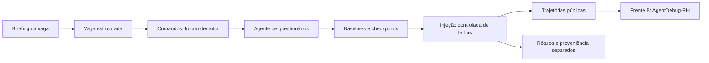

# Scenario Emulator · Frente A

[🇺🇸 English](README.md) · 🇧🇷 **Português**

Simulador de falhas em agentes de recrutamento. Gera questionários, registra
trajetórias de execução e constrói datasets controlados para avaliar o
**AgentDebug-RH**, responsável por localizar a falha crítica e propor uma correção.

[Começar](#começar) · [Guia da Frente A](docs/error-recovery.pt-BR.md) ·
[Desenvolvimento](#desenvolver) · [Catálogo de falhas](docs/fault-injection-catalog.pt-BR.md) ·
[Contrato de dados](docs/data-contracts/agentdebug.pt-BR.md)



As campanhas medem a localização da causa crítica em trajetórias com falhas
conhecidas e os falsos positivos em controles corretos.

O agente avaliado trabalha em português do Brasil: prompts, tools, briefings de
vaga e trajetórias geradas estão em português. Código, documentação e saída dos
comandos estão em inglês.

## Começar

Requisitos: **Python 3.12+**, Git e [`uv`](https://docs.astral.sh/uv/). Gerar
novas baselines também exige um provider de LLM; testes e validação de
configurações funcionam sem LLM. Execute todos os comandos a partir da raiz do
repositório, pois os caminhos de perfis e campanhas são relativos ao diretório
de trabalho.

1. Clone o repositório e instale as dependências travadas:

   ```bash
   git clone https://github.com/PDC-PDAI/scenario-emulator.git
   cd scenario-emulator
   uv sync --locked
   cp .env.example .env
   ```

2. Configure um provider no `.env`. Para OpenAI:

   ```dotenv
   LLM_PROVIDER=openai
   OPENAI_API_KEY=your-key
   OPENAI_MODEL=gpt-5-mini
   ```

   Para Ollama, configure `LLM_PROVIDER=ollama`, `OLLAMA_BASE_URL` e
   `OLLAMA_MODEL` conforme o [.env.example](.env.example). Langfuse é opcional:
   com as três credenciais `LANGFUSE_*` vazias, nada é rastreado e o runtime usa
   os prompts locais de `src/prompts/raw_prompts.py`. Com credenciais, os prompts
   vêm do Langfuse pelo `LANGFUSE_PROMPT_LABEL`, com fallback para as cópias
   locais em caso de erro.

3. Verifique a instalação sem LLM:

   ```bash
   uv run scenario-emulator validate-profile configs/fronts/error_recovery.yaml
   uv run pytest -q
   ```

4. Gere uma baseline real. Este comando chama o provider configurado:

   ```bash
   uv run scenario-emulator run \
     --profile configs/fronts/error_recovery.yaml \
     --brief "Vaga sênior de backend Python, FastAPI e PostgreSQL" \
     --benign 1
   ```

   O comando grava `scenario.json`, `benchmark.jsonl`, `agent-debug.jsonl` e
   `trajectories/` em `outputs/error_recovery/` e informa quantas trajetórias
   passaram no oráculo do cenário. `error_recovery` também é o perfil padrão
   quando `--profile` é omitido; sem `--benign`, ele gera três comandos
   benignos. O [guia da Frente A](docs/error-recovery.pt-BR.md#gerando-trajetórias)
   mostra como gravar cada execução em um diretório próprio.

## Campanha atual: 300 amostras por modelo

A [campanha fixa](configs/campaigns/front-a-fixed-300.yaml) coleta
**300 amostras por modelo: 60 controles corretos e 240 falhas injetadas**. O
[corpus versionado](configs/inputs/front-a-300.json) tem 10 vagas × 30 comandos
distintos. Todos os modelos recebem as mesmas vagas, comandos, IDs, diretrizes e
prompts locais; nenhum LLM gera essas entradas novamente. O modelo padrão é o
**Gemma 4 31B**, via OpenRouter.

1. Configure `OPENROUTER_API_KEY` no `.env` (veja [.env.example](.env.example)).
   A campanha fixa ignora `LLM_PROVIDER`: chama o OpenRouter com essa chave (ou
   com `OPENAI_API_KEY` quando `OPENAI_BASE_URL` aponta para o OpenRouter) e
   sempre usa os prompts locais.

2. Valide a campanha e as 300 entradas, sem chamar LLM:

   ```bash
   uv run scenario-emulator validate-dataset-campaign configs/campaigns/front-a-fixed-300.yaml
   ```

3. Rode um piloto de cinco amostras do Gemma 4 31B em um diretório próprio:

   ```bash
   uv run scenario-emulator run-dataset \
     --campaign configs/campaigns/front-a-fixed-300.yaml \
     --limit 5 \
     --output-dir outputs/front-a-smoke-5/gemma-4-31b
   ```

4. Rode a coleta completa de 300 amostras do Gemma 4 31B. Ela grava em
   `outputs/front-a-300/google-gemma-4-31b-it`:

   ```bash
   uv run scenario-emulator run-dataset \
     --campaign configs/campaigns/front-a-fixed-300.yaml
   ```

5. Colete outro modelo com as mesmas entradas e parâmetros. `--model` muda
   somente o modelo e grava em `outputs/front-a-300/<ID do modelo com / trocado por _>`:

   ```bash
   uv run scenario-emulator run-dataset \
     --campaign configs/campaigns/front-a-fixed-300.yaml \
     --model qwen/qwen3.5-9b
   ```

O YAML fixa `temperature=0`, `top_p=1`, `max_tokens=8192`, reasoning desativado,
2 retries de transporte, timeout de 120 segundos e seed 42 para distribuir as
falhas. O OpenRouter recebe `require_parameters=true` e `allow_fallbacks=false`.

### Situação das coletas

| Modelo | ID no OpenRouter | Situação |
| --- | --- | --- |
| [Gemma 4 31B](https://openrouter.ai/google/gemma-4-31b-it) | `google/gemma-4-31b-it` | Completa: 300 amostras (60 controles, 240 falhas), roteamento padrão do OpenRouter. |
| [Qwen 3.5 9B](https://openrouter.ai/qwen/qwen3.5-9b) | `qwen/qwen3.5-9b` | Completa: 276 amostras com roteamento padrão e 24 retomadas em `deepinfra/bf16` com o contrato de contagem exata ([detalhes](#retomada-do-qwen-com-orçamento-e-contrato-de-contagem-exata)). |
| [GLM 5.2](https://openrouter.ai/z-ai/glm-5.2) | `z-ai/glm-5.2` | Completa: 300 amostras em `deepinfra/fp4` ([detalhes](#modelos-glm)). |
| [GLM 5.3 Flash](https://openrouter.ai/z-ai/glm-5.3-flash) | `z-ai/glm-5.3-flash` | Incompatível com o protocolo: nenhuma amostra aceita. |
| [Gemma 4 26B](https://openrouter.ai/google/gemma-4-26b-a4b-it) | `google/gemma-4-26b-a4b-it` | Não coletado; use o passo 5 com este ID. |

Os datasets coletados ficam no diretório `outputs/`, ignorado pelo git, da
máquina que os executou; o clone não os inclui. Cada modelo concluído tem uma
pasta de entrega, `drive-five-jsons/`, descrita em
[Empacotar uma entrega](#empacotar-uma-entrega).

### Distribuição

`success_controls: 60` reserva seis controles corretos por vaga, selecionados com
seed fixa. Os 240 casos restantes recebem os onze tipos de falha: 22 por tipo,
exceto `system_llm_limit` e `system_environment_error`, com 21 cada. A mesma
posição é controle ou recebe o mesmo tipo de erro em todos os modelos. O piloto
usa o prefixo exato da campanha completa; cinco casos não representam as
proporções globais.

### Entrada do detector e métricas

Entregue ao detector o `detector-input.jsonl`, que contém somente
`trajectory_id`, `task_description`, `environment` e `steps`, misturando
controles e falhas. `labels.json` fica separado: `null` significa nenhuma falha
esperada; os outros valores têm `step`, `module` e `error_type`. Cruze as
predições com os rótulos por `trajectory_id` somente depois da inferência. Não
entregue ao detector os rótulos, o manifesto, a atribuição de falhas nem o campo
`success`.

`front-b-input.jsonl` preserva o contrato legado com `success` para integração.
Como a Frente B pode pular casos com `success=true`, meça falsos positivos com a
entrada cega e processe todos os casos. Veja o
[protocolo de avaliação](docs/dataset-v2-success-controls.pt-BR.md#como-avaliar-falsos-positivos).

### Posição das falhas

`invalid_action`, `action_format_error`, `system_tool_execution_error` e
`system_llm_limit` alternam entre os passos com chamadas de ferramentas válidas,
usando três variantes por posição. Ao injetar antes do fim, a trajetória é
truncada no erro para não apresentar uma continuação bem-sucedida fictícia. Os
demais tipos preservam a posição semanticamente necessária (por exemplo, salvar
antes de consultar ou corromper o payload ao salvar). Não acrescentamos passos só
para balancear posições. Em baselines de dois passos, a distribuição planejada dos
240 erros é 92 no passo 1 e 148 no passo 2; com mais passos, os tipos flexíveis
também cobrem posições intermediárias. A distribuição real, inclusive tipo × passo
e comprimento original, fica em `private/distribution.json`.

### Reprodução e retomada

Repita o mesmo comando e diretório para reutilizar os checkpoints aprovados. Uma
baseline que falha ou contém erro natural recuperado fica pendente com seu ID
original; a próxima execução repete o mesmo comando, sem substituí-lo nem
deslocar os rótulos. O processo retorna código 2 enquanto houver pendências, e
apenas uma baseline válida recebe a falha sintética. Cada caso de falha contém
uma única injeção; os controles preservam a trajetória correta. Controles exigem
lookup e salvamento bem-sucedidos, com chamadas e respostas consistentes no
histórico completo. Tentativas rejeitadas ficam em
`private/rejected-executions/`.

O manifesto privado registra o protocolo e seus hashes. Por isso, mudar modelo,
parâmetros de geração, corpus, código, dependências ou `--limit` exige outro
diretório de saída: o hash do runtime cobre todos os arquivos de `src/` e o
`uv.lock`, e uma divergência interrompe a execução com
`Protocol/model/limit changed`. Use diretórios separados para piloto e coleta
completa e, ao avaliar, mantenha os mesmos IDs de entrada no mesmo split entre
modelos.

Temperatura 0 fixa a política de amostragem, mas o OpenRouter e seus backends não
garantem respostas idênticas em novas chamadas. O protocolo fixa entradas,
parâmetros e mutações; os checkpoints preservam os resultados já coletados.

### Retomar com um endpoint específico do OpenRouter

Para fixar o roteamento após uma decisão experimental explícita, mantendo os
comandos, os parâmetros de geração e os checkpoints já aprovados:

```bash
LANGFUSE_TRACING_ENABLED=false AGNO_DEBUG=false uv run python -m scripts.run_fixed_dataset_with_provider \
  --campaign configs/campaigns/front-a-fixed-300.yaml \
  --model qwen/qwen3.5-9b \
  --provider deepinfra/bf16 \
  --max-parallel 5
```

Para um exemplo de cinco amostras, acrescente
`--limit 5 --output-dir outputs/qwen-provider-smoke-5`. Repita o comando completo
enquanto houver pendências. A validação dos casos e a atribuição de
controles/falhas permanecem iguais. O roteamento é uma alteração operacional
explícita: `order` fixa o endpoint; `require_parameters=true` e
`allow_fallbacks=false` continuam ativos. Temperatura zero não garante a mesma
resposta em backends diferentes.

O manifesto e `private/run-config.json` registram cada fase e o roteamento por
amostra, distinguindo os checkpoints coletados pelo roteamento padrão dos
coletados no endpoint escolhido. A auditoria vincula cada registro ao hash do
checkpoint e ao hash do script de retomada. Esses metadados ficam fora da entrada
do detector.

### Retomada do Qwen com orçamento e contrato de contagem exata

A coleta do Qwen foi concluída com dois scripts específicos para ele. Ambos leem
e gravam `outputs/front-a-300/qwen_qwen3.5-9b` e compartilham o ledger em dólares
`private/budget-usd1-20260919.json`. Não apague o ledger: reexecutar um comando
usa o mesmo saldo.

```bash
LANGFUSE_TRACING_ENABLED=false AGNO_DEBUG=false uv run python -m scripts.run_qwen_budgeted
LANGFUSE_TRACING_ENABLED=false AGNO_DEBUG=false uv run python -m scripts.run_qwen_exact_count
```

- `run_qwen_budgeted` executa uma rodada dos casos pendentes fixada em
  DeepInfra/BF16, preservando os checkpoints aprovados e os parâmetros da
  campanha.
- `run_qwen_exact_count` retoma os casos ainda pendentes com um contrato de tool
  mais estrito: o schema de `salvar_formulario` exige, em modo strict,
  exatamente a quantidade de perguntas solicitada, e sua descrição repete essa
  quantidade. Os prompts de sistema e de usuário não mudam. Um salvamento
  bem-sucedido conclui a tarefa correta mesmo que o provider falhe em um turno
  posterior. `--probe generation-NNN` executa um único caso pendente e só o
  mantém se for aceito.

Antes de cada tentativa HTTP, inclusive retries do cliente, o transporte reserva
um teto de custo: o tamanho serializado do request em bytes mais 16.384 tokens de
enquadramento como entrada (limitado ao contexto de 262.144 tokens), mais 8.192
tokens de saída, com margem de 10%. Cada request fixa DeepInfra/BF16 e limita o
preço a US$ 0,10 por milhão de tokens de entrada e US$ 0,15 por milhão de saída,
sem tarifa por request ([preços do endpoint](https://openrouter.ai/api/v1/models/qwen/qwen3.5-9b/endpoints)).
Ao receber o custo final do OpenRouter, a reserva é substituída por esse custo
com a margem. Chamadas interrompidas ou sem custo final conservam toda a reserva,
e uma chamada que não cabe no saldo é bloqueada antes de chegar à rede.

O teto do ledger só aumenta por uma alteração registrada e autorizada. O ledger
do Qwen começou em US$ 1,00 e foi elevado para US$ 1,50 em 21/09/2026; ao fim da
coleta, registrava um teto comprometido de US$ 1,04 e custo reportado de
US$ 0,08. O teto limita o gasto; não garante que o modelo produza casos
aprovados.

O dataset resultante mistura protocolos: 276 casos usaram o contrato original com
roteamento padrão, e 24 usaram o contrato de contagem exata em DeepInfra/BF16. O
`run-config.json` da entrega lista os IDs ajustados; informe-os ao comparar o
Qwen com os outros modelos.

### Modelos GLM

O modelo informado inicialmente como “GLM 3.5 Flash” foi confirmado como
[GLM 5.3 Flash](https://openrouter.ai/z-ai/glm-5.3-flash) (`z-ai/glm-5.3-flash`).
Na verificação de 21/09/2026, os endpoints `gmicloud/fp8`, `z-ai/fp8`,
`deepinfra/fp4` e `fireworks` recusaram `reasoning.enabled=false` com HTTP 400:
`Reasoning is mandatory for this endpoint and cannot be disabled.` A coleta não
produziu amostras aceitas. Este modelo permanece incompatível com o protocolo
atual; habilitar reasoning exige registrar a diferença experimental.

O substituto selecionado foi o [GLM 5.2](https://openrouter.ai/z-ai/glm-5.2)
(`z-ai/glm-5.2`), pelo endpoint `deepinfra/fp4`. A coleta foi concluída com
**300 amostras validadas: 60 controles e 240 falhas**, sem pendências, após
retomar 11 casos afetados por erros de infraestrutura. As sondagens retornaram
zero tokens de reasoning, e todas as execuções registram reasoning desativado. A
coleta usou uma cópia isolada do runtime original do Gemma, com hash
`c4b0a44dd666ab15a3ee7b2cf369286750910929fc9164da029a494004ab54e4`, o mesmo
corpus e a mesma atribuição de falhas; as adaptações posteriores específicas do
Qwen não se aplicam a ela.

### Empacotar uma entrega

Cada modelo concluído tem uma pasta `drive-five-jsons/` com cinco JSONs e a
entrada de replay da Frente C:

| Arquivo | Conteúdo |
| --- | --- |
| `detector.json` | Entrada do detector como array JSON, sem rótulos nem `success` |
| `labels.json` | Rótulos por `trajectory_id`; `null` para controles |
| `fronta300.json` | O corpus fixo usado na coleta |
| `run-config.json` | Parâmetros de geração, roteamento, hashes e histórico |
| `manifest.json` | Distribuição, hashes da entrega e metadados da campanha |
| `frontc-replay.json` | Conversas sem rótulos e pontos de retomada para a Frente C |

`scripts/package_front_a_delivery.py` gera os cinco JSONs. Ele foi escrito para a
coleta do Qwen e também registra o ledger de orçamento e a fase de contagem exata
do Qwen, então só funciona nessa coleta. `scripts/package_front_c_replay.py`
acrescenta `frontc-replay.json` a qualquer pasta de entrega que já tenha
`detector.json`, `run-config.json` e `manifest.json`, e usa por padrão os caminhos
do Gemma 4 31B. Estes comandos reconstroem a entrega do Qwen:

```bash
uv run python -m scripts.package_front_a_delivery \
  --dataset outputs/front-a-300/qwen_qwen3.5-9b \
  --release outputs/front-a-300/qwen_qwen3.5-9b/drive-five-jsons \
  --model qwen/qwen3.5-9b

uv run python -m scripts.package_front_c_replay \
  --dataset outputs/front-a-300/qwen_qwen3.5-9b \
  --release outputs/front-a-300/qwen_qwen3.5-9b/drive-five-jsons \
  --model qwen/qwen3.5-9b
```

Os dois scripts param a menos que os 300 casos estejam presentes e válidos.

## Reproduzir as campanhas anteriores

| Configuração | Resultado planejado | Dependência |
| --- | --- | --- |
| [100 casos](configs/campaigns/error-recovery-front-b-100.yaml) | Quatro classes de `action` | Novas baselines via LLM |
| [220 casos](configs/campaigns/error-recovery-front-b-220.yaml) | 20 casos por classe, 11 classes | Novas baselines via LLM |
| [1.100 casos](configs/campaigns/error-recovery-front-b-1100.yaml) | 100 casos por classe; cinco falhas distintas por baseline | Baselines privadas da campanha de 220; expansão offline |
| [1.200 casos v2](docs/dataset-v2-success-controls.pt-BR.md) | 1.100 falhas + 100 controles revisados | Pacote anterior, auditoria e controles aprovados |

```bash
uv run scenario-emulator run-dataset \
  --campaign configs/campaigns/error-recovery-front-b-220.yaml \
  --max-parallel 10

# Depois de concluir a coleta de 220 baselines:
uv run scenario-emulator run-dataset \
  --campaign configs/campaigns/error-recovery-front-b-1100.yaml
```

Essas campanhas usam o provider configurado no `.env`. As mutações são aplicadas
sobre checkpoints salvos de execuções reais: são **injeções sintéticas em
trajetórias**, não novas execuções do agente sob falha. Uma nova coleta com LLM
reproduz o procedimento, não textos idênticos.

```text
outputs/<campanha>/
├── front-b-input.jsonl   # entrada agregada para o detector
├── front-b-inputs/       # um JSON por trajetória
├── labels.json           # ground truth; somente para avaliação
└── private/              # baselines, checkpoints e proveniência
```

Mantenha rótulos fora da entrada do detector e agrupe derivados da mesma baseline
no mesmo split. Para medir falsos positivos com os controles v2, consulte o
[protocolo de avaliação cega](docs/dataset-v2-success-controls.pt-BR.md#como-avaliar-falsos-positivos).

## Integração com AgentDebug-RH

O [exemplo autocontido de `invalid_action`](examples/error_recovery/invalid_action/README.pt-BR.md)
funciona sem os datasets históricos. A Frente A produz o contrato `Trajectory`;
a Frente B gera o diagnóstico; o re-rollout pertence à Frente C. Este repo não
executa recuperação nem demonstra ganho após correção.

## Desenvolver

```bash
uv run ruff check .
uv run pytest -q
```

| Diretório | Responsabilidade |
| --- | --- |
| `src/services/questionnaire/` | Agente, tools e validação do formulário |
| `src/services/dataset/` | Coleta retomável, mutações e exportação de campanhas |
| `src/services/agent_debug/` | Conversão e anotações de trajetórias |
| `src/schemas/` | Contratos Pydantic e taxonomia |
| `src/prompts/` | Prompts locais e resolução opcional pelo Langfuse |
| `scripts/` | Sincronização de prompts, controles v2, retomadas com provider/orçamento e empacotamento de entregas |
| `tests/` | Contratos, integração, falhas e persistência sem chamadas a modelos |

Veja a [seção de desenvolvimento](docs/error-recovery.pt-BR.md#arquitetura-e-desenvolvimento)
para adicionar uma falha, alterar contratos e validar a construção dos datasets.

**Política de idioma.** Comentários, docstrings, ajuda do CLI, logs e exceções
estão em inglês. Textos lidos pelo modelo ou gravados em artefatos gerados
permanecem em português: prompts, docstrings e respostas das tools, textos das
falhas injetadas, strings de trajetórias e anotações, problemas de auditoria e
notas de manifesto. Os YAML e JSON das campanhas são entradas experimentais e não
mudam. Traduzir qualquer um deles alteraria o comportamento do agente ou tornaria
as novas coletas incomparáveis com as existentes.

## Documentação

Toda página tem a versão em inglês indicada no topo.

| Assunto | English | Português |
| --- | --- | --- |
| Execução e campanhas | [Guide](docs/error-recovery.md) | [Guia](docs/error-recovery.pt-BR.md) |
| Arquitetura e desenvolvimento | [Guide](docs/error-recovery.md#architecture-and-development) | [Guia](docs/error-recovery.pt-BR.md#arquitetura-e-desenvolvimento) |
| Injeção de falhas | [Catalog](docs/fault-injection-catalog.md) | [Catálogo](docs/fault-injection-catalog.pt-BR.md) |
| Rótulos no step 3 | [Note](docs/step-3-labels.md) | [Nota](docs/step-3-labels.pt-BR.md) |
| Contrato A → B | [Contract](docs/data-contracts/agentdebug.md) | [Contrato](docs/data-contracts/agentdebug.pt-BR.md) |
| Controles de sucesso v2 | [Protocol](docs/dataset-v2-success-controls.md) | [Protocolo](docs/dataset-v2-success-controls.pt-BR.md) |
| Exemplo `invalid_action` | [Case](examples/error_recovery/invalid_action/README.md) | [Caso](examples/error_recovery/invalid_action/README.pt-BR.md) |
